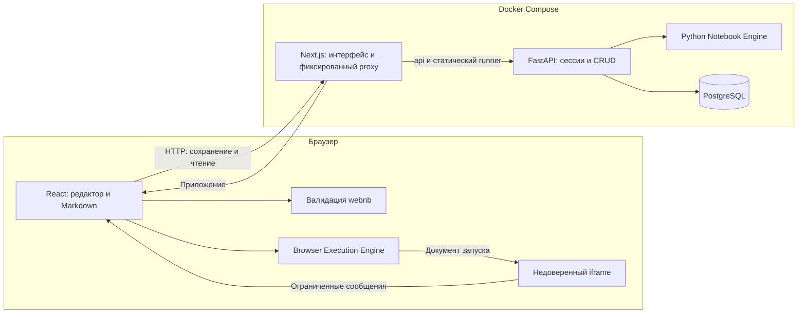
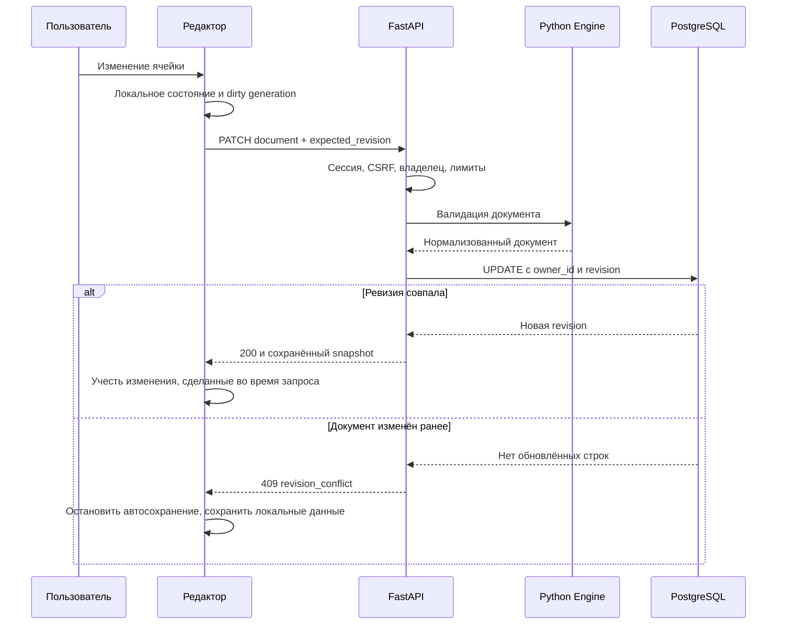

# Архитектура Web Notebook

Статус: технический проект этапа 0 согласован 20 ноября 2026 года. Действующие уточнения P-001–P-009 и история их принятия находятся в [журнале](decisions.md). Этап 1 выполнен и ожидает приёмки: инфраструктура собрана, запущена и проверена, результаты — в [отчёте](stage-1-report.md). Последующие этапы не начаты.

## Компоненты и границы доверия



В браузере живут редактирование, Markdown и сборка preview. React не вставляет пользовательский HTML в DOM приложения. Внутренний compiler не зависит от React или HTTP; адаптер preview отвечает за iframe и сообщения. Чистая модель документа отделена от UI-состояния (фокус, открытые меню, индикатор сохранения) и от состояния запуска (runId, console, iframe).

FastAPI — единственный владелец бизнес-операций, авторизации, валидации перед сохранением и транзакций. Next.js обслуживает интерфейс и, по предложению P-001, проксирует только фиксированные адреса backend. Произвольный URL клиента не становится целью прокси. Проксирование cookies, CSRF-заголовков, статусов и ограничений тела проверяется отдельно. Возможность внешних rewrites описана в [документации Next.js](https://nextjs.org/docs/app/api-reference/config/next-config-js/rewrites); совместимость конкретной версии ещё не проверена.

## Почему два движка

Python Notebook Engine читает и проверяет данные формата. Сервер не обладает DOM пользователя и не должен становиться исполнителем недоверенных программ. Выполнение на сервере потребовало бы отдельной изоляции и расходовало ресурсы backend, не помогая воспроизвести веб-страницу в браузере.

Browser Execution Engine использует браузерную модель DOM/CSS/JavaScript, быстро пересобирает документ без сетевого обращения и применяется также для HTML-экспорта. Полноценный compiler на Python не нужен. Общими являются спецификация формата и тестовые документы, а не два компилятора страницы.

## Сохранение



Ручное сохранение проходит через ту же очередь, что и автоматическое. Ответ не заменяет более свежий локальный документ. После ошибки сети исход неизвестен: перечитать серверную ревизию и сравнить snapshot, не отправлять слепо повторную запись. Импорт создаёт новый блокнот владельца; не переопределяет существующий документ по ID из файла.

## Предлагаемая структура

Это целевая структура; на этапе 1 созданы инфраструктурные файлы frontend/backend, настройки и тесты. Формат, движки, пользовательские модели и остальная функциональность будут добавляться на соответствующих этапах.

```text
NIR/
  master_prompt.md
  frontend/
    src/
      app/
      components/{notebook,cells,preview}/
      features/{auth,notebooks,autosave,import-export}/
      lib/{notebook-format,execution-engine}/
      types/
    tests/
  backend/
    app/{api,core,models,schemas,services,db}/
    notebook_engine/
    preview/                 # статический runner, без пользовательского кода
    alembic/
    tests/
  schemas/                   # общая JSON Schema формата
  fixtures/notebooks/        # общие корректные и некорректные примеры
  docs/
  docker-compose.yml
  .env.example
  README.md
```

Структура не требует дополнительных сервисов, event bus, Redis или универсальных repository-абстракций. SQLAlchemy sessions и сервисы с явными транзакциями достаточны для MVP.

## Основные риски

| Риск | Мера и предел |
| --- | --- |
| Расхождение Python/TypeScript | Одна спецификация и schema, общие fixtures, проверка нормализации |
| Потеря изменений | Атомарный revision, очередь сохранения, сохранение локального snapshot при конфликте |
| Неверная изоляция | Отдельная CSP runner, минимальный sandbox, реальные браузерные тесты |
| Зависание JS | Документировать ограничение iframe; тестировать в отдельном браузерном процессе |
| Утечки через сеть | Принят P-007: ограничение перечисленных каналов с документированным отсутствием абсолютной сетевой изоляции; требуется фактическая проверка |
| Рост сложности | Ограниченный формат, полная пересборка, отсутствие инкрементального исполнения |
| Устаревшие зависимости | Проверка стабильных версий, совместимости и lock-файлы на этапе 1 |

Подробности: [формат](notebook-format.md), [БД](database.md), [API](api.md), [Browser Engine](browser-execution-engine.md), [Python Engine](python-notebook-engine.md), [безопасность](security.md).
