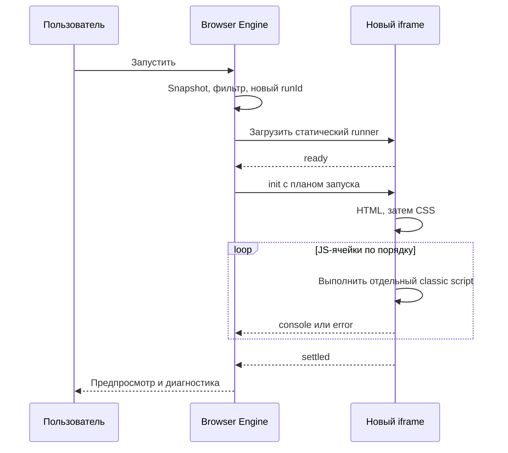

# Browser Execution Engine

Статус: архитектура этапа 0 согласована 20 ноября 2026 года, включая уточнённые P-005/P-006. Реализация не разрешена и не начата. Браузерных проверок пока нет.

## Контракт

Предлагаемые части TypeScript-модуля:

- `compile(document)` возвращает упорядоченные HTML/CSS/JS-фрагменты с ID и диагностикой; не обращается к React, сети или БД.
- `mountPreview(plan, container)` создаёт новый iframe и протокол одного запуска.
- `resetPreview()` удаляет iframe, отписывает обработчики и делает предыдущий runId недействительным.
- `buildExportHtml(document)` формирует самостоятельный файл с той же семантикой активных ячеек.

Compiler принимает проверенный immutable snapshot документа. Ошибка валидации не уничтожает локальные правки. Предыдущий preview перед новым исполнением удаляется. Изменения после snapshot относятся к следующему запуску.

## Алгоритм запуска

1. Проверить модель и лимиты; зафиксировать snapshot.
2. Отфильтровать активные программные ячейки, разделить по типам с сохранением порядка внутри каждой группы.
3. Создать случайный runId, сбросить предыдущий iframe и консоль; UI показывает «Подготовка».
4. Создать iframe со статическим `/preview/runner`, `sandbox="allow-scripts allow-modals"` и `referrerpolicy="no-referrer"`. Runner не содержит документа и не принимает его через HTTP. В HTTP CSP runner используется тот же набор разрешений sandbox, без allow-same-origin.
5. После первого `ready` от нового iframe передать ровно один `init` с runId и планом. Таймаут готовности — предлагаемые 5 секунд, только диагностический.
6. Внутри iframe установить мост консоли и обработчики ошибок до пользовательского кода.
7. Разобрать и очистить каждый HTML-фрагмент в контексте body, добавить в body по порядку.
8. Создать отдельный `style` для каждой CSS-ячейки через `textContent`, добавить в head по порядку. После этого DOM и CSS готовы.
9. Создать отдельный classic `script` для каждой JS-ячейки через `textContent`, вставить синхронно в порядке массива. Пользовательский JavaScript не исполняется в parent.
10. Передать `settled` после попытки запуска всех синхронных фрагментов. Это означает завершение начальной сборки, а не всех timers/promises/обработчиков событий. Preview остаётся интерактивным.



## HTML и CSS

Предложение P-005: каждый HTML-source — самостоятельный body-фрагмент; нельзя открывать тег в одной ячейке и закрывать в другой. Фрагменты разбираются отдельно, результат добавляется последовательно без служебных обёрток между ними. Это сохраняет DOM-соседство. Повторные DOM `id` не переименовываются автоматически; действуют правила браузера, возможна диагностика.

Документы с `doctype/html/head/body` не являются поддерживаемой формой ячейки; нужна ошибка с указанием ячейки и просьбой использовать фрагмент, а не молчаливое преобразование целой страницы. Разбор выполняется внутри изолированного runner, не через DOM приложения и не одним регулярным выражением.

Перед вставкой HTML разбирается внутри runner с явной политикой разрешённых конструкций. Исключаются `script`, `link`, `base`, `meta`, `iframe`, `object`, `embed`, SVG/MathML и атрибуты `srcdoc`, `ping`, `autofocus`; запрещаются `javascript:` и внешние resource URLs. Разрешены обычная семантическая разметка, формы как неотправляемые элементы, raster data-изображения, локальные `#anchor`, обработчики `on*`, атрибут `style` и элементы `style`. Список элементов/атрибутов становится явной конфигурацией с тестами на этапе 6. Удаления сопровождаются диагностикой и не изменяют сохранённый `source`.

Обработчики сохраняют нативную семантику браузера (`this`, `event`, возвращаемое значение); автоматического переписывания в addEventListener нет. Запрет тегов script относится к исходному HTML и разделению ячеек, а не является защитой от произвольного JavaScript: JS-ячейки и обработчики уже имеют право исполнять код внутри iframe. Граница защиты — sandbox, CSP и проверки приложения/API. До команды «Запустить» HTML и обработчики не устанавливаются в исполняемую среду; после запуска события могут исполнять их автоматически, например onerror.

Нативные alert/confirm/prompt разрешаются через allow-modals в iframe и HTTP CSP. Синхронная семантика не подменяется асинхронной эмуляцией. Браузер может подавлять диалоги; обещание одинакового поведения без браузерных проверок не даётся. Навязчивые диалоги и циклы остаются риском доступности, таймер parent не гарантирует их прекращение.

Отключение HTML-ячейки после следующего запуска убирает её DOM, обработчики и стили. Отключение JS-ячеек убирает только их код: обработчики активного HTML сохраняются, но вызов ими функции из отключённой JS-ячейки может дать ReferenceError. Массовая команда называется «Отключить все программные ячейки» либо явно указывает тип; отключение только JS-ячеек нельзя обозначать как запрет всего JavaScript.

Элементы style из HTML сохраняют порядок HTML-фрагментов. CSS-ячейки добавляются затем в head, но порядок дерева DOM (head перед body), специфичность и !important определяют каскад: более поздняя вставка в head сама по себе не даёт приоритета над style внутри body. Отключение CSS-ячеек не убирает стили активного HTML. Это правило проверяется на этапе 6 и сохраняется в HTML-экспорте.

CSS-ячейки — отдельные таблицы стилей. Ошибочный CSS обрабатывается браузерным CSS-parser; полная диагностика CSS не обещается. Отдельные style-элементы не позволяют незакрытому комментарию одной ячейки поглотить соседнюю. Порядок ячеек влияет на каскад, но специфичность и `!important` продолжают действовать.

Отключение CSS удаляет соответствующую таблицу только при следующем запуске. Браузер использует оставшийся CSS, inline styles HTML и свои стили. Это не гарантирует, что визуально изменится каждый элемент. Отключение HTML убирает его DOM-узлы; JS-запрос может вернуть `null`. Engine не создаёт отсутствующие узлы: возникший TypeError выводится в консоль, дальнейшие JS-ячейки запускаются согласно политике ошибок.

## JavaScript: область видимости и ошибки

Рекомендуется общий глобальный контекст classic scripts в одном запуске. Переменные доступны последующим ячейкам по стандартным правилам JavaScript; `let`/`const` не становятся свойствами `window`. Повторное глобальное `let` может вызвать SyntaxError. Между запусками контекст не сохраняется. Не поддерживаются `import`/`export`, top-level await и внешние модули; `eval`/`new Function` запрещаются CSP.

Отдельный script сохраняет различие ошибок: SyntaxError предотвращает исполнение только этого фрагмента; runtime error прекращает текущий фрагмент после уже совершённых изменений, но не откатывает DOM/переменные. Следующая ячейка всё равно запускается. Если ошибка повредила общую среду или код завис, продолжение не гарантируется. Обёртка `try/catch` вокруг всего содержимого каждой ячейки не используется: она изменила бы глобальную область видимости.

Отслеживать `error`, `unhandledrejection`, текущий ID синхронной ячейки; добавлять безопасный `sourceURL` из проверенного ID для диагностики. Для асинхронных ошибок точный ID может быть неизвестен — тогда `cellId: null`, а не выдуманное соответствие. Событие загрузки ресурса и JavaScript exception различать.

Порядок гарантируется для синхронного верхнего уровня ячеек. Promises, microtasks и timers подчиняются event loop браузера; следующая ячейка не ждёт их завершения. Асинхронный callback может исполниться после более поздней ячейки. Эти правила и поведение отдельных classic scripts основаны на [HTML Standard](https://html.spec.whatwg.org/multipage/scripting.html#the-script-element); конкретная сборка будет проверена в браузерах.

## Контексты вставки и экспорт

В preview source передаётся как данные и присваивается `textContent` элемента script/style уже внутри iframe. Он не интерполируется в сырой HTML. Поэтому `</script>`, `</style>`, кавычки и U+2028/U+2029 в source не становятся границами HTML-элементов.

Для `.html` использовать фиксированный bootstrap и JSON payload с обязательным экранированием `<` как `\u003c`, а также U+2028/U+2029. Payload читается JSON-parser, затем source вставляется через тот же DOM-процесс. Не сериализовать сырые пользовательские script/style в итоговый HTML. Отдельно проверить смешанный регистр закрывающих тегов, `<!--`, обратные слеши и двойное экранирование.

Standalone-файл содержит активные программные ячейки, не Markdown и не мост привилегий к приложению. JS выполняется при открытии; перед скачиванием интерфейс предупреждает об этом и об отсутствии гарантий sandbox самостоятельного файла. Meta CSP может ограничивать часть загрузок, но не считается эквивалентом sandbox/HTTP-заголовков. Открытие через `file://` — обязательная проверка этапа 8.

## Протокол консоли v1

Предлагаемый конверт iframe → приложение:

```json
{"protocol":"webnb-preview","version":1,"runId":"run-uuid","seq":1,"type":"console","payload":{"level":"log","cellId":"cell-4","args":[{"kind":"string","text":"Привет"}]}}
```

Сообщения передаются JSON-строками, чтобы получатель проверял длину до разбора. Разрешённые события после init: `started`, `console`, `error`, `diagnostic`, `settled`. `ready` — отдельный конверт без runId, принимаемый только в состоянии подготовки и только один раз. `init` — отдельная команда с планом, максимум 6 MiB; в ней нет cookie, CSRF-токена, owner_id и иных документов.

Для `console`: level — log/info/warn/error; args — массив описаний значений. `error`: kind — syntax/runtime/unhandledrejection; message, ограниченный stack, cellId или null. `diagnostic`: code, message, cellId или null. У started/settled пустой payload. Поля неизвестного типа и лишние поля отклоняются.

Parent проверяет `event.source === activeIframe.contentWindow`, ожидаемое opaque `origin === "null"`, длину, схему, runId и возрастающий seq. Одного `origin === "null"` недостаточно. Старые iframe/runId игнорируются. Runner принимает init только от `parent`, с точным origin приложения из доверенной конфигурации, до исполнения кода и однократно. В сторону opaque iframe нужен `targetOrigin="*"`; передача разрешается только свежему статическому runner до запуска пользовательского кода. Любой дополнительный load/повторный ready прерывает сессию; документ не пересылается после навигации. Из iframe в parent задаётся точный origin приложения. Основа правил source/origin и проверки данных — [HTML Standard, web messaging](https://html.spec.whatwg.org/multipage/web-messaging.html#security-9).

Предлагаемые лимиты: 32768 UTF-16 code units на строку сообщения, дополнительно 32 KiB UTF-8 после разбора; 20 аргументов; глубина 3; 50 полей объекта; 2000 символов одного строкового значения; 100 сообщений/с; кольцевой буфер 1000 записей. Лимиты применяются у отправителя и получателя. Переполнение агрегируется в одну запись о пропусках; очистка консоли очищает UI-буфер без запуска кода.

Сериализатор учитывает циклы, bigint, undefined, функции, DOM, Error; не вызывает пользовательский `toJSON` и getters, использует ограниченное чтение data descriptors. Proxy traps и другие эффекты пользовательского кода невозможно полностью нейтрализовать: при ошибке выводится маркер, при зависании действуют ограничения iframe. React выводит строки как текст, не HTML. Время получения выставляет parent.

Сообщения недоверенны даже от правильного iframe: пользовательский код находится в том же realm, может подделывать логи или ломать мост. runId предотвращает смешивание запусков, но не является секретом и не даёт авторизацию. Ни одно сообщение preview не вызывает CRUD, сохранение или доступ к сессии.

## Сброс и ограничения

Сброс удаляет iframe, буферы и подписки; новый запуск создаёт новый DOM, глобальный JS-контекст и таймеры. Таймаут готовности не является механизмом прекращения произвольного JS. Бесконечный цикл может заблокировать поток так, что кнопка сброса и parent-таймер не отработают. Реальное поведение проверяется отдельно, без обещания гарантированной остановки.
