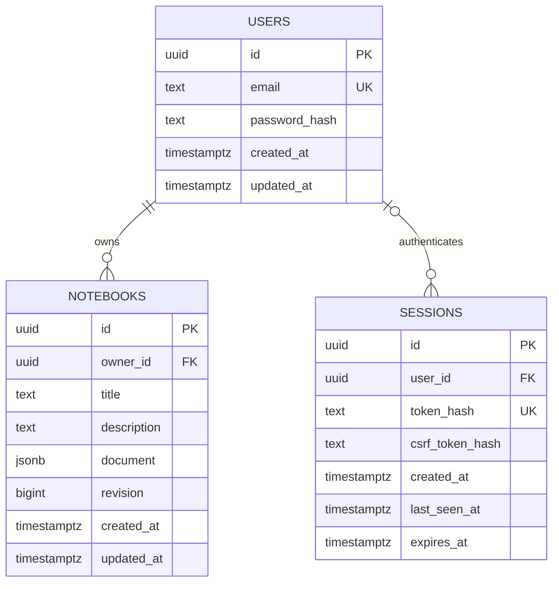

# Модель данных

Статус: проект этапа 0 согласован 20 ноября 2026 года. PostgreSQL и JSONB заданы ТЗ; таблица сессий и параметры ниже приняты в P-002/P-008. На этапе 1 подключён PostgreSQL 19.0, настроены SQLAlchemy и Alembic, выполнены upgrade head/current/check без бизнес-ревизий. Описанные ниже таблицы и миграции ещё не реализованы — это этап 3.

## Users

UUID создаётся сервером. `email` обязателен, ограничен 254 символами и уникален после согласованной нормализации. Предлагается использовать проверенный email-валидатор и приведение адреса к нижнему регистру для сравнения аккаунтов, без provider-specific удаления точек или `+suffix`. Пароль не нормализуется. `password_hash` хранит строку Argon2id с параметрами и солью; исходный пароль не сохраняется и не журналируется. Времена — UTC `timestamptz`, сериализация RFC 3339.

## Notebooks

Все поля обязательны, описание может быть пустой строкой. FK `owner_id -> users.id ON DELETE CASCADE`; публичной операции удаления аккаунта MVP не требует, но ограничение БД обеспечивает удаление его документов при административном удалении пользователя.

`document` — нормализованный `.webnb`. Поля `title` и `description` — проекции `document.metadata`, обновляемые в одной транзакции; отдельно менять их нельзя. Предлагаются CHECK-ограничения совпадения проекций, `jsonb_typeof(document) = 'object'`, `revision >= 1` и необходимых полей метаданных. Полную валидацию выполняет Python Engine.

UUID блокнота, владелец, revision и даты не помещаются внутрь `.webnb`. Создание/импорт/копия начинают revision с 1. Изменение документа увеличивает её ровно на 1; отсутствие изменения не требует запроса сохранения.

Индекс `(owner_id, updated_at DESC, id)` обслуживает список собственных документов. PK используется при чтении конкретного документа совместно с условием владельца. GIN по JSONB не нужен: поиск по содержимому не входит в MVP.

JSONB выбран потому, что блокнот читается и сохраняется целиком, порядок уже задан массивом, а история и совместное редактирование исключены. Отдельная таблица ячеек потребовала бы дополнительных операций упорядочивания и транзакций. Компромисс JSONB — при изменении одной ячейки переписывается документ; размеры ограничены спецификацией. PostgreSQL не сохраняет оформление JSON и порядок ключей объектов, поэтому переносимый экспорт формируется сериализатором, а не копированием исходного JSON-текста из БД. [Свойства JSONB](https://www.postgresql.org/docs/current/datatype-json.html).

## Sessions

В cookie — случайный секрет не менее 256 бит; в БД — его SHA-256, уникальный индекс и срок жизни. Это хеш высокоэнтропийного токена, не замена Argon2id для паролей. CSRF-токен имеет отдельный секрет и хеш.

`user_id` допускает NULL только для краткой предварительной сессии получения CSRF перед регистрацией/входом. Предлагаемые сроки: 10 минут для предварительной сессии; 7 суток абсолютного срока и 24 часа бездействия для авторизованной. При входе предварительная сессия удаляется, ID и секреты меняются. Выход удаляет текущую сессию. Индексы — уникальный `token_hash`, `user_id`, `expires_at`; FK на пользователя с CASCADE.

Просроченные записи не принимаются независимо от очистки. Очистка выполняется служебной задачей приложения; отдельный сервис не требуется. Создание предварительных сессий ограничивается частотой. Конкретные сроки приняты в составе P-002; изменение требует обсуждения.

## Оптимистическая запись

В одной транзакции: проверить владельца, проверить документ, выполнить UPDATE с условиями `id`, `owner_id` и `revision = expected_revision`, увеличить revision и вернуть запись. Не разделять сравнение и запись на незащищённые операции. Для чужого или отсутствующего ID ответ 404; для собственного документа с несовпавшей revision — 409.

Удаление также проверяет ожидаемую ревизию, чтобы не удалить изменения из другой вкладки. Копирование получает согласованный snapshot с проверкой ревизии источника и создаёт новый ID и владельца текущего пользователя. Владелец не принимается из входного тела.
