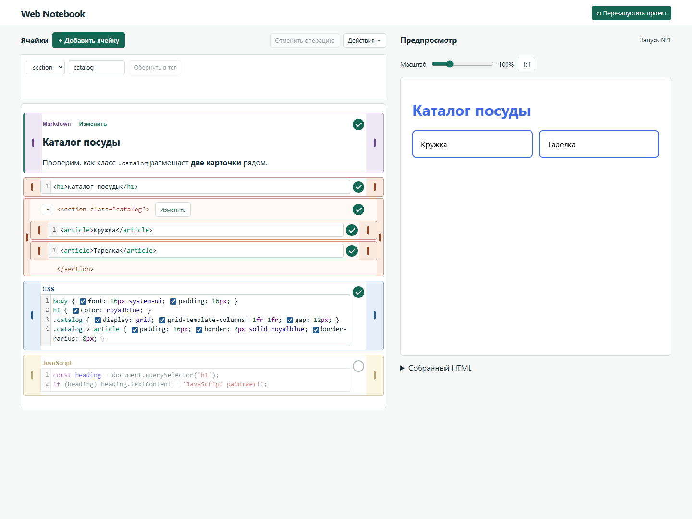
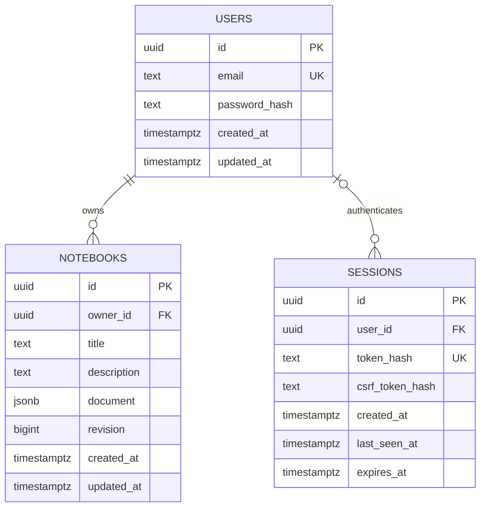
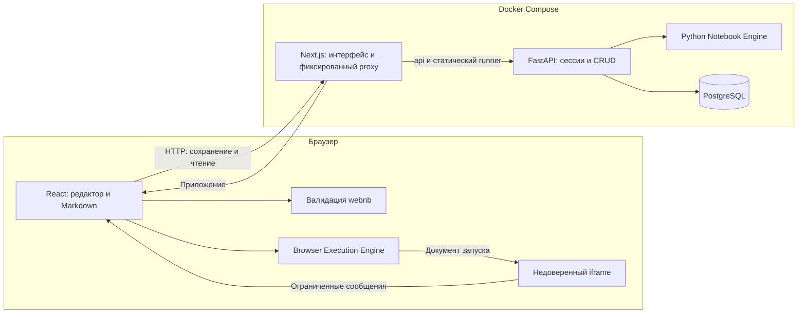
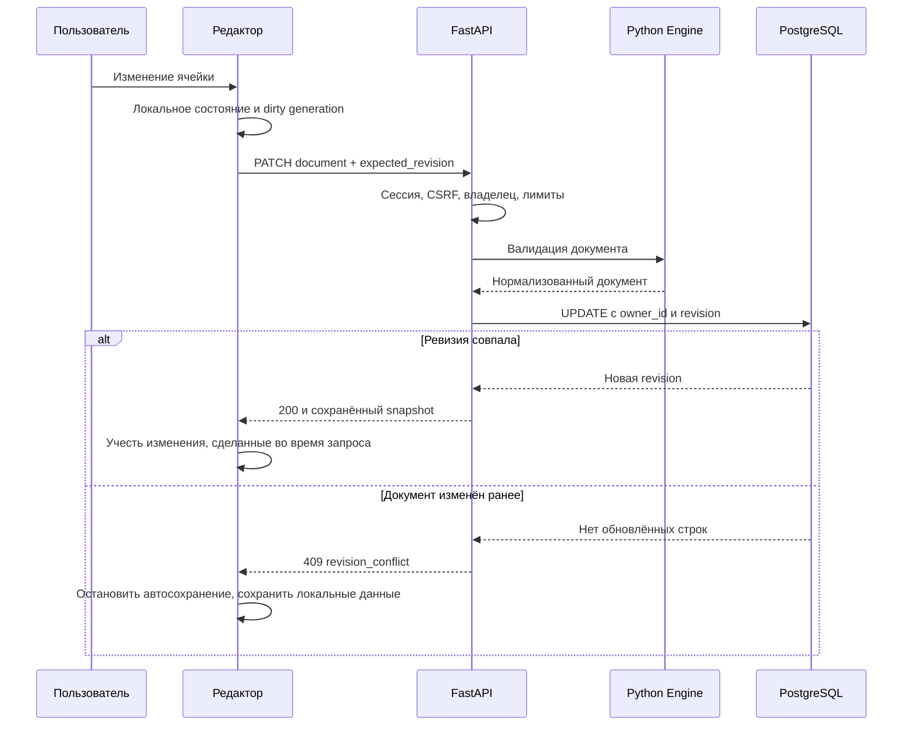
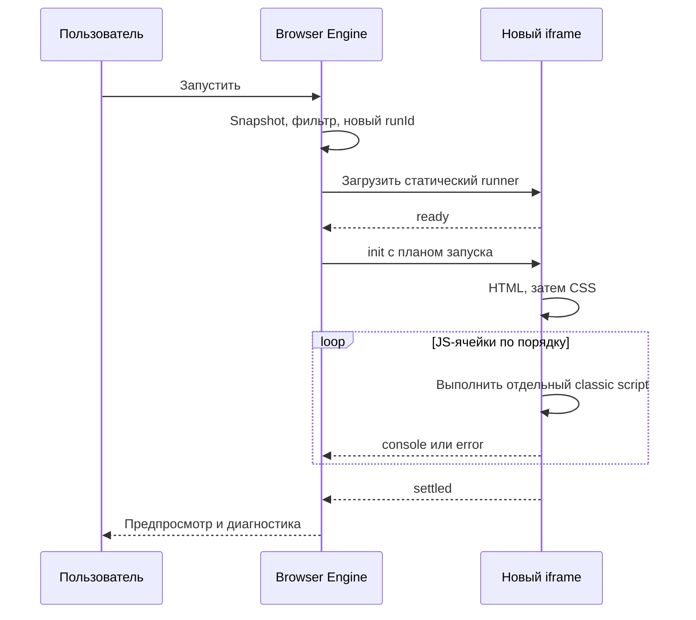

# Web Notebook · рабочая документация

## Текущая сдача · 23 ноября 2026

**D-013.** По решению заказчика сдаём однопользовательскую версию демо. Ориентир по внешнему виду и взаимодействию — D-012 и снимок ниже. Next.js/React/TypeScript и CodeMirror отвечают за редактор и исполнение в браузере. FastAPI читает и атомарно сохраняет один JSON-файл. Авторизация, PostgreSQL, каталог, импорт и экспорт исключены из этой сдачи. При расхождении с прежним планом применять этот раздел. Прежний этап 3 остановлен: ревизия Alembic `751690a8e2df` сгенерирована, команда применения не выполнялась.

**D-014.** Для интерфейса основной версии использовать shadcn/ui и общие токены темы, включая оформление вокруг CodeMirror. Сохранять ориентиры демо: спокойный фон, читаемый код, различимые типы ячеек и заметные основные действия. Для привычных операций использовать подписанные кнопки и стандартные состояния компонентов. У декоративных элементов должна быть понятная функция.

| Этап новой сдачи | Результат | Проверка для перехода |
|---|---|---|
| A · Модель блокнота | Контракт хранения ячеек и HTML-групп, проверка дерева в Python | Круговой перенос JSON, проверка порядка, типов, ID, родителей, вложенности и черновиков |
| B · Локальное хранение | GET/PUT `/api/notebook`, атомарная запись файла, запуск приложения без PostgreSQL | Сохранение и чтение после перезапуска, некорректный запрос сохраняет последний валидный файл |
| C · Редактор | Главная страница Next.js, операции дерева, типы из контракта, CodeMirror и Markdown. Взаимодействие по D-012, оформление на shadcn/ui по D-014 | Проверки операций, клавиатуры, группировки и перетаскивания в браузере |
| D · Предпросмотр | Изолированный iframe, активные HTML/CSS/JS, переключатели объявлений, полный перезапуск, масштаб и диагностика | DOM и CSS после переключений, чистый JS-контекст, блокировка запуска с переходом к строке |
| E · Сборка для сдачи | Подключение Ctrl+S к API, восстановление черновика, воспроизводимый запуск и сверка с демо | Production-сборка и сквозной сценарий от первого открытия до сохранения, перезапуска и исправления ошибки |

**Контракт A.** Версия внутреннего JSON равна 1. Поле `cells` — упорядоченный массив. Типы: `html`, `css`, `javascript`, `markdown`, `group`. Порядок соседей задаёт порядок в массиве. У HTML и группы поле `parent` ссылается на ID группы либо равно null. Все узлы имеют ID, название и собственный флаг активности. У ячеек есть исходный текст, у группы — тег, классы и состояние сворачивания. Отключение отдельного объявления CSS сохраняется внутри исходника, как в демо. Сервер проверяет структуру; синтаксические ошибки в пользовательском коде допускаются при сохранении черновика.

**Отчёт A · 23 ноября.** Реализована [модель документа](../backend/app/notebook.py) и [проверки структуры](../backend/tests/test_local_notebook.py). В существующем образе `web-notebook-backend-tests:local` с `--network none` выполнено `pytest -q -p no:cacheprovider tests/test_local_notebook.py tests/test_notebook_engine.py`: 107/107, из них 14 для внутреннего документа и 93 для прежнего движка. Проверены пустой документ, версия, четыре типа и группа, round-trip черновиков и CSS-отметок, порядок, дубли ID, отсутствующий и неверный родитель, циклы, граница восьми уровней и ограничения размера. В этот прогон API и UI не входили.

**Отчёт B · 23 ноября.** Реализованы GET/PUT `/api/notebook`, поле конфигурации `NOTEBOOK_PATH` и [файловое хранилище](../backend/app/storage.py). Первый GET возвращает пустой блокнот. PUT проверяет модель A, записывает временный файл в тот же каталог, сбрасывает его содержимое на диск и заменяет целевой файл. Конкурирующие сохранения заменяют документ целиком; действует последняя успешная замена. Дерево с повторным ID получает 422. Ошибка файловой системы или повреждение документа при чтении дают 503. Readiness проверяет каталог и чтение документа.

Проверки B: весь backend-набор в тестовом образе без сети — 114/114, один DeprecationWarning Starlette о транспорте httpx в TestClient. Собран runtime-образ, отдельный Compose-проект `webnb-stageb-check` с одним backend достиг healthy. Через HTTP проверены начальный GET, PUT незаконченного JS, отказ 422 без изменения сохранённого документа, GET после `up --force-recreate`. Тест сбоя замены отдельно проверил сохранность старого файла и очистку временного. Frontend-сборка и браузерный сценарий в B не запускались.

**Этап C · промежуточный отчёт, 23 ноября.** Начата реализация редактора на главной странице Next.js по графитово-синему макету. Добавлены клиентская модель и операции дерева, UI, CodeMirror, Markdown и диагностика HTML/CSS/JavaScript. Воспроизведён пропуск в демо: для CSS с `color: 17px` и неизвестным свойством функция проверки вернула `undefined`. Для продукта подключены parse5 и css-tree. Установка зависимостей завершилась успешно.

Работа остановлена после первого `npm run typecheck`: 10 сообщений в компоненте редактора. Девять связаны с обращением к полям разных вариантов результата проверки обёртки, одно — с типом элемента DOM при переходе к ошибке. Следующий шаг после решения заказчика — явно различить варианты результата, уточнить тип DOM-элемента и повторить typecheck. Проверки операций дерева, диагностик и взаимодействия в браузере, а также сборка ещё не выполнены. Этап C не принят.

[Решения](#dec) · [Запуск](#run) · [Формат](#format) · [Этап 3: БД и API](#storage) · [Редактор и preview](#preview) · [Приёмка](#qa)

**Итог C · 23 ноября.** После разрешения продолжить уточнены типы результата проверки обёртки и DOM-элемента CodeMirror. Главная страница Next.js открывает редактор с примером в памяти. Графитово-синий интерфейс поддерживает светлую и тёмную тему. Закреплённая панель показывает количество отмеченных блоков. Двойной щелчок по контуру отмечает HTML-ячейку или группу, Shift расширяет диапазон, ПКМ открывает команду группировки. Панель диагностики показывает название и строку активного блока и раскрывает предков при переходе к ошибке.

Итоговые проверки: typecheck, check:webnb и production-сборка прошли. Vitest — 120/120, включая 23 теста диагностики и 5 операций дерева. Playwright в Edge на standalone-сборке — 6/6: группировка и отмена, DnD, Markdown с клавиатуры и вставка ячейки, переход к строке в свёрнутой группе и переключение активности, CSS-свойства и значения, редактирование обёртки. Запрос readiness в этих сценариях подменён. Backend и интеграционные инфраструктурные тесты в итоговый прогон C не входили. Статические проверки не определяют ошибки времени исполнения JavaScript или итоговое вычисленное значение CSS-переменной. Разбор редактора дан в чате; тест понимания ожидает явного завершения объяснения. Этап D ожидает согласования.

**Этап D · промежуточный отчёт.** Добавлены статический runner FastAPI с отдельным HTTP CSP, сборка активного дерева и запуск в новом sandbox-iframe, масштаб 25–300%, вывод сообщений и команда перезапуска. TypeScript прошёл. В отдельном Compose-проекте backend runtime собран, frontend остановился на `npm ci` до сборки Next.js: npm сообщил `Missing: fsevents@2.3.3 from lock file`. Браузерные проверки этапа D не запускались. Рекомендуемое продолжение — обновить lock-файл в чистом окружении с версией npm из frontend-образа, сверить diff, повторить Compose-сборку и сквозные проверки. Решение ожидает согласования заказчика.

**Итог D · 23 ноября.** Lock-файл обновлён в чистом контейнере из frontend/Dockerfile (Node 24.22.3, npm 11.19.1). Запись fsevents 2.3.3 восстановлена как optional. В отдельном Compose-проекте webnb-stage-d прошли npm ci, typecheck и production-сборка, оба сервиса достигли healthy. Проверочный адрес — http://localhost:3020, совпадает с APP_ORIGIN.

Предпросмотр получает снимок активных ячеек через одноразовую инициализацию MessageChannel. Порт создаёт документ runner, редактор проверяет окно, opaque origin и идентификатор запуска. Полный запуск заменяет iframe. При синтаксической ошибке снимок остаётся прежним; масштаб меняет только отображение. Ctrl+S на этапе D запускает текущий код. Сохранение документа в API относится к E.

Проверки: Vitest 120/120, в Edge на production-сборке 11/11 (6 редактора, 5 предпросмотра). Проверены HTTP CSP и sandbox, вложенность DOM, собственные флаги детей, независимые CSS-декларации, новый JS-контекст, масштаб без перезапуска, Ctrl+S и сохранение предыдущего результата при ошибке, inline-обработчик, журнал и переход ко второй строке ошибки выполнения. Полная проверка сетевых ограничений и других браузеров в этот прогон не входила. Объяснение дано в чате; тест понимания ожидает явного завершения объяснения. Этап E ожидает согласования.

## История и результаты прежнего плана

**Промежуточный отчёт этапа 3.** Добавлены SQLAlchemy-описания users, sessions и notebooks, подключена metadata к Alembic. В pyproject.toml и uv.lock закреплены argon2-cffi 25.1.0 и email-validator 2.4.0. PostgreSQL запущен через Compose с проверкой healthy; тестовый backend-образ успешно собран. Генерация ревизии через compose run остановилась до запуска Alembic: Docker Desktop принял относительный путь backend/alembic за имя volume. Миграция не создана и не применена, реализация сессий и проверка API ещё впереди. Предложено повторить генерацию с абсолютным путём Windows либо скопировать сгенерированную ревизию из отдельно созданного контейнера. Тесты этапа 3 ещё не запускались.

**Этап 3, уточнение P-002, 22 ноября — согласовано заказчиком.** Для каждой сессии GET /api/auth/csrf возвращает стабильный токен HMAC-SHA-256 от секрета текущей cookie с отдельным серверным ключом. БД хранит хеш токена. При входе секреты меняются, выход отзывает сессию. Повторный bootstrap во второй вкладке сохраняет работоспособность первой. Отклонён вариант ротации при каждом bootstrap.

| Этап | Выполнено и проверено |
|---|---|
| 0, 18–20 ноября | Проект и P-001–P-009 согласованы. Аудит 12 документов, 28 ссылок, 4 JSON-примеров и ограждений 4 диаграмм; Mermaid не рендерился. |
| 1, 20–21 ноября | Compose build/up, три healthy, единственный опубликованный порт frontend, Alembic upgrade/current/check, реальный SELECT 1, сохранение записи после пересоздания db и удаление контрольной таблицы. Исправлена кодировка init-env для PS 5.1, повторный запуск сохранил .env. После Swagger: 4 backend и 3 Chromium E2E прошли (главная, 503 с повтором, Try it out обоих health). |
| 2, 21–22 ноября | Python-пакет, JSON Schema, сгенерированные типы и Ajv-валидаторы, 87 общих fixtures. В финальном прогоне Python 93/93 в Docker без сети/БД, TypeScript 92/92 в Windows, check:webnb прошёл. Исправлено ожидаемое экранирование JSON Pointer в fixtures; Rolldown 1.2.19 закреплён в devDependencies после ошибки native binding. Vite предупредил о будущем configLoader. Production/E2E в этот прогон не входили. Разбор notebook_engine и тест понимания по четырём темам завершены 22 ноября. |

<a id="dec"></a>
## Журнал решений

| ID | Принято | Основание |
|---|---|---|
| D-001 | Next.js App Router, React, строгий TypeScript; FastAPI; PostgreSQL; локальный Docker Compose | Раздел 3 |
| D-002 | Универсальный блокнот с Markdown, HTML, CSS, JavaScript; без функций учебной платформы | Разделы 1, 4, 13 |
| D-003 | Выполнение только по команде «Запустить», полная пересборка активных программных ячеек, новый контекст каждого запуска | FR-06, FR-07 |
| D-004 | Browser Execution Engine работает на клиенте; Python Notebook Engine обрабатывает документы и не зависит от FastAPI/SQLAlchemy | Раздел 3.4, FR-08, FR-15 |
| D-005 | Пользовательский код не выполняется на сервере или в контексте React; iframe с изолированным происхождением и отдельной CSP | FR-09, раздел 7 |
| D-006 | HTTP-only cookies, CSRF-защита, проверка владельца; без долгоживущих токенов в localStorage | FR-01, раздел 7 |
| D-007 | Документ хранится в JSONB; переносимый `.webnb` не содержит владельца, сессий и других приватных данных | FR-13, раздел 5 |
| D-008 | CodeMirror 6; безопасный Markdown, GFM и формулы; русский интерфейс и документация | Раздел 3.1, FR-04, FR-05 |
| D-009 | Импорт/экспорт `.webnb`, экспорт активной страницы `.html`, ручное и автоматическое сохранение с защитой от конфликтов | FR-12–FR-14 |
| D-010 | Перед этапами — план и разрешение; после этапов — фактические проверки и согласование; приложение не писать до принятия этапа 0 | Протокол согласования и сообщение заказчика |
| D-011 | Swagger UI доступен через Next.js на /api/docs, OpenAPI — /api/openapi.json. Схема содержит внешние /api-пути, сервер задаётся относительным URL /; Try it out использует текущий origin приложения. Порт 8000 остаётся внутренним. ReDoc и OAuth redirect не включаются, поскольку они не требовались | 21 ноября 2026, отдельное согласование |

| ID | Действующее решение | Обоснование и альтернатива |
|---|---|---|
| P-001 | Один origin приложения, проксирование фиксированных `/api/*` и `/preview/runner` из Next.js в FastAPI. Три сервиса Compose, меньше настроек cookies/CORS | Разные frontend/API origins: меньше проксирования, больше настроек CORS и cookies; отдельный reverse proxy: дополнительный сервис |
| P-002 | Непрозрачные серверные сессии в PostgreSQL, Argon2id, synchronizer CSRF token; немедленный отзыв при выходе | Подписанная cookie: меньше запросов к БД, но сложнее отзыв; JWT не даёт преимуществ для этого MVP |
| P-003 | Строгий `.webnb` 1.0, JSON Schema 2020-12 как машиночитаемая часть спецификации, неизвестные свойства отклонять; лимиты в [спецификации](#format) | Открытые metadata удобнее для расширений, но усложняют переносимость, лимиты и валидацию |
| P-004 | Отдельный classic script на JS-ячейку, общий глобальный контекст в рамках запуска; после обычной ошибки перейти к следующей ячейке | Функция на ячейку изолирует переменные; единый скрипт останавливает все ячейки при синтаксической ошибке; modules меняют модель обмена переменными |
| P-005 | HTML-ячейки — body-фрагменты; атрибуты обработчиков `on*`, inline styles и `<style>` разрешены. Теги `<script>` в исходном HTML запрещены, отдельные скрипты размещаются в JS-ячейках. Нативные alert/confirm/prompt разрешаются с учётом ограничений браузера | Полный запрет обработчиков слишком ограничивает привычный HTML; поддержка встроенных script потребовала бы дополнительных правил порядка. Эмуляция диалогов не сохраняет их синхронную семантику |
| P-006 | Статический runner с собственной CSP, загружаемый в `sandbox="allow-scripts allow-modals"`; без allow-same-origin; пользовательский документ передаётся только в браузере | `srcdoc` проще доставки, но требует совместить наследуемую CSP приложения с выполнением скриптов; отдельный origin runner требует дополнительной настройки |
| P-007 | Честно ограничить гарантию сети блокировкой перечисленных каналов через CSP и sandbox; проверить навигацию собственного iframe и прочие каналы отдельно | Строгий запрет любого исходящего трафика потребует пересмотра среды исполнения, например управляемой изолированной браузерной среды; это выходит за текущую простую архитектуру |
| P-008 | Полная замена документа с `expected_revision`, атомарная проверка БД, 409 при конфликте; debounce 1000 мс и одна запись в полёте | PATCH отдельных ячеек сложнее согласовать с порядком и ревизией; last-write-wins теряет изменения |
| P-009 | Подтверждение удаления непустой ячейки и блокнота; Markdown-callouts INFO/TIP/WARNING; HTTPS-изображения из списка разрешённых origins | Undo требует дополнительного состояния; любые HTTPS-картинки проще пользователю, но расширяют внешние обращения |

20 ноября первоначальный запрет inline-обработчиков и стилей заменён P-005; P-006 дополнен allow-modals как для iframe, так и для HTTP CSP. Ограничение SVG/MathML сохранено. P-007 уточняет исходное ТЗ о сети. Новые решения датировать и сохранять историю замен.

## Границы и этапы

### D-012 · Редактор и HTML-контейнеры

23 ноября 2026 года заказчик зафиксировал текущую версию демо как ориентир для внешнего вида и поведения итогового редактора. На этапах 4–8 сверять с ним компоновку, взаимодействие с ячейками и результат запуска. Точные размеры и оттенки допускают адаптацию. [Исходник демо](../demo/WebNotebookDemo.tsx) · [Оформление](../demo/WebNotebookDemo.css)



- На широком экране слева располагаются дерево и редакторы ячеек, справа — предпросмотр и раскрываемый «Собранный HTML» последнего запуска. На узком экране панели идут друг за другом. Текущая ячейка определяет место вставки. Единая команда «Добавить ячейку» предлагает HTML, CSS, JavaScript или Markdown. HTML вставляется после текущего элемента на том же уровне. Остальные типы размещаются в корне, для вложенной текущей ячейки — после её внешней группы.
- При прокрутке списка кнопка «+ Добавить ячейку» остаётся рядом с заголовком «Ячейки». Меню типов появляется по нажатию. После вставки редактор прокручивается к созданной ячейке. «Перезапустить проект» находится в верхней панели.
- У HTML и обёрток терракотовые края, у CSS синие, у JavaScript янтарные, у Markdown сиреневые. Поле ввода светлое, с тонкой границей. Щелчок по левому или правому краю выделяет HTML-ячейку или обёртку зелёным контуром. Shift + щелчок задаёт диапазон. Для группировки нужны **минимум два соседних** HTML-элемента одного родителя. Под причину недоступности команды зарезервировано место. Круглая галочка справа управляет активностью, отдельная стрелка слева сворачивает группу.
- Пользователь задаёт тег контейнера (`div`, `section`, `article`, `main`, `header`, `footer`, `nav`, `aside`) и необязательные CSS-классы; оба свойства можно редактировать после группировки. Группа занимает позицию первого выбранного элемента. ID, исходники, активность и взаимный порядок детей сохраняются. В предпросмотре и HTML-экспорте активная группа создаёт ровно один DOM-элемент, а фрагменты детей становятся его непосредственным содержимым. У плоской HTML-ячейки сохраняется семантика P-005.
- Перемещение поддерживает кнопки «Выше» и «Ниже», перенос в группу и вынос на уровень выше, а также перетаскивание с указанием места перед элементом, после него или внутри группы. Группа перемещается с поддеревом. Для каждого элемента допустим один родитель; циклы запрещены. Максимум восемь уровней **групп**, считая внешнюю первым. Вложенность разметки внутри отдельной HTML-ячейки этим лимитом не измеряется.
- Для сборки нужны включённый элемент и включённые предки. Выключение группы сохраняет собственные переключатели детей; сворачивание меняет вид дерева. «Разгруппировать» поднимает детей на место контейнера с сохранением их порядка и активности. После выноса ребёнка группа может остаться с одним элементом: минимум в два применяется только при создании. Удаление группы с содержимым требует подтверждения; последнюю структурную операцию можно отменить до следующего редактирования.
- Обёртка выглядит как пара тегов на одной вертикали. Между ними с отступом расположены дети, общий контур охватывает группу целиком. Щелчок по закрывающему тегу выбирает группу. «Изменить» открывает текст пары тегов. Ошибочный тег или несовпадающая пара блокируют применение.
- Перенос можно начать с любой части ячейки вне поля ввода, включая свободное место справа от названия типа. Внутри редактора текстовый курсор позволяет выделять код с первого нажатия. У ближайшей допустимой цели появляется одна синяя линия с подписью места вставки. Остальные ячейки сохраняют свои позиции.
- CodeMirror подсвечивает синтаксис, выводит подсказки поверх соседних блоков и нумерует строки с 1 в каждом редакторе. Markdown отображается как форматированная заметка. Двойной щелчок или «Изменить» открывает исходник, Shift+Enter или «Готово» возвращает к чтению.
- В CSS отдельная галочка у каждого объявления позволяет выключить его и включить обратно. Выключенное объявление остаётся в тексте зачёркнутым. Повторяющиеся свойства переключаются независимо, сохраняется порядок каскада.
- В демо кнопка перезапуска, изменение структуры, переключение ячейки или CSS-объявления создают новый документ предпросмотра и заново выполняют включённые JS-ячейки. Набор текста оставляет правки в редакторе. Ctrl+S сохраняет блокнот в браузере и запрашивает полный запуск. Масштаб 25–300% и кнопка 1:1 действуют только на предпросмотр.
- Синтаксическая ошибка в активном коде блокирует запуск. Ошибочный блок выделяется красным. Сообщение содержит название, тип, номер строки внутри блока и причину. Щелчок раскрывает родительские группы и переводит курсор к строке. До исправления виден последний успешный результат, при первом неуспешном запуске окно пустое. Ctrl+S позволяет сохранить черновик ячеек с ошибкой.

**Уточнение по Markdown.** В редакторе заметка всегда доступна. Переключатель активности показывается у программных ячеек и HTML-групп. Чтение и редактирование Markdown не перезапускают предпросмотр.

**Макет для обсуждения оформления.** В варианте shadcn/ui по адресу `/design/` можно переключать светлую и тёмную тему. Цвета страницы внутри iframe задаёт автор блокнота. У ячейки есть корзина и контекстное меню с перемещением и удалением. Эти детали доступны для оценки перед этапом C.

**При переносе в продукт.** Порядок HTML определяет DOM, порядок CSS — каскад, порядок JavaScript — выполнение. Для текущей сдачи применять D-013. Для прежнего расширенного плана остаётся согласовать поводы запуска с D-003 и FR-07.

**Пример приёмки.** Сгруппировать две соседние карточки в `section.catalog`, поменять их местами, вынести одну наружу и запустить. Селектор `.catalog > article` применяется только к оставшейся карточке. Выключение и повторное включение группы восстанавливает только ранее активных детей. Попытка создать группу из одной карточки недоступна.

**Совместимость.** Проверенные валидаторы и схема `.webnb` 1.0 описывают плоские документы. Перед сохранением групп согласовать следующую версию формата и проверить чтение существующих 1.0, сохранение дерева и round-trip. Демо фиксирует взаимодействие; схема хранения групп и реализация этих функций в основном приложении относятся к дальнейшей работе.

Личный веб-блокнот. Исключения MVP — раздел 13 ТЗ. Для сроков, состава ВКР и сценария защиты использовать разделы 9–12 ТЗ.

| Требование | Решение | Этап | Проверка |
|---|---|---|---|
| FR-01 Аутентификация | Cookies, сессии, CSRF, владелец | 3 | Интеграционные проверки входа/выхода и чужого ID |
| FR-02 Блокноты | Список, создание, открытие, переименование, копия, удаление | 3, 4, 8 | CRUD и E2E |
| FR-03 Ячейки | Упорядоченный массив, четыре типа, комментарий и сворачивание | 2, 4 | Unit операций и UI |
| FR-04 Редактор | CodeMirror 6, языки, отступы, номера строк, клавиатура | 4 | Компонентные и ручные проверки |
| FR-05 Markdown | Без raw HTML; GFM, KaTeX, изображения, информационные блоки | 5 | Рендеринг и XSS-набор |
| FR-06 Активность | `enabled` только программным ячейкам; массовые действия | 2, 4, 6 | Unit + E2E изменения результата после запуска |
| FR-07 Выполнение | Полная пересборка, без состояния прошлого запуска | 6 | Порядок, повторный запуск, отсутствие автозапуска |
| FR-08 Browser Engine | Компиляция и управление iframe на клиенте | 6 | Unit сборки и браузерные проверки |
| FR-09 Изоляция | Sandbox, CSP, независимая проверка API | 6 | Браузерные тесты угроз в согласованных границах P-007 |
| FR-10 Консоль | Типизированные ограниченные сообщения, runId | 6, 7 | Протокол, ошибки, переполнение, устаревшие сообщения |
| FR-11 Интерфейс | Слева ячейки, справа preview/консоль; узкий экран вертикально | 4, 7 | E2E, клавиатура, адаптивность |
| FR-12 Сохранение | Debounce, ручное сохранение, revision, видимые состояния | 3, 8 | Гонки запросов, конфликт, сетевой сбой |
| FR-13 Формат | Переносимый строгий JSON 1.0 | 2 | Общие fixtures Python/TypeScript |
| FR-14 Перенос | `.webnb` round-trip, самостоятельный `.html` | 8 | Импорт/экспорт и открытие HTML из файла |
| FR-15 Python Engine | Независимый пакет с Pydantic | 2 | Unit без приложения и БД |

| Этап |Последовательность работ | Приёмка |
| --- | --- | --- |
| 0 Проектирование | Документы, варианты решений, форматы, контракты, угрозы, диаграммы; согласование | Полный технический проект и явное решение по P-001–P-009 |
| 1 Инфраструктура | Выбор совместимых версий → Next/FastAPI → PostgreSQL/SQLAlchemy/Alembic → proxy → Compose/env/health | Чистая сборка и запуск; frontend обращается к API, API к БД |
| 2 Формат | Schema и fixtures → Python/TS-модели → строгий parse/validate → сериализация | Общие корректные/некорректные документы дают согласованные результаты |
| 3 Пользователи и хранение | Миграции → сессии/CSRF/password → CRUD → revision → изоляция владельцев | Интеграционные тесты на PostgreSQL и конкурентное сохранение |
| 4 Редактор | Список/создание → CodeMirror/типы → операции → title/comment/collapse → enabled и массовые действия | Документ редактируется, код сам не запускается |
| 5 Markdown | Просмотр/редактирование → GFM → изображения → KaTeX → callouts → URL/XSS | Все требуемые виды контента и безопасный рендеринг |
| 6.1 Engine | После начала этапа 6 отдельно подтвердить CSP/runner и ограничения среды без интерфейсных улучшений | Реальные browser tests безопасности, решение по выявленным ограничениям |
| 6.2 Engine | Compiler → HTML/CSS/JS → lifecycle/reset → ошибки → проверка порядка | Активность меняет результат после запуска, среда пересоздаётся |
| 7 Консоль/preview | Протокол → буфер/лимиты → панель → ошибки/очистка → адаптивность | Результаты и диагностика видимы; недоверенные сообщения безопасно отклоняются |
| 8 Сохранение/перенос | Очередь/debounce → ручной save → состояния/конфликты → webnb import/export → HTML | Reload и round-trip без потери данных; standalone HTML работает |
| 9 Полная проверка | Unit/integration/E2E/security → адаптивность → чистая Compose-сборка → исправления | Критерии MVP подтверждены фактическими проверками |
| 10 ВКР и демонстрация | Актуализировать README/docs/диаграммы → результаты тестов → демонстрационный блокнот → сценарий защиты | Воспроизводимый запуск и демонстрация на другой машине |

<a id="run"></a>
## Работа с проектом

Для текущей сдачи нужен Docker Desktop в режиме Linux. Из корня репозитория:

```powershell
docker compose up -d --build --wait
Invoke-RestMethod http://localhost:3000/api/health/ready
Invoke-RestMethod http://localhost:3000/api/notebook
```

Swagger доступен по `/api/docs` на том же адресе. Опубликован порт frontend на loopback. Next.js проксирует `/api/*` в FastAPI. Backend хранит документ в `/app/data/notebook.json` в томе `notebook_data`. Обычная остановка `docker compose down` сохраняет этот том. Пустой каталог допустим при первом запуске.

```powershell
docker --context desktop-linux compose -f docker-compose.yml -f docker-compose.test.yml build backend
docker --context desktop-linux compose -f docker-compose.yml -f docker-compose.test.yml run --rm --no-deps backend
```

```powershell
Set-Location frontend
npm.cmd ci --no-audit --no-fund
$env:PLAYWRIGHT_BROWSERS_PATH = Join-Path (Split-Path (Get-Location).Path) '.artifacts\playwright'
node node_modules/@playwright/test/cli.js install chromium
npm.cmd run test:e2e
Set-Location ..
```

Для unit-проверок в frontend дополнительно npm.cmd run typecheck, npm.cmd run test:unit и npm.cmd run check:webnb. npm.cmd run generate:webnb обновляет типы и валидаторы после изменения схемы. .artifacts/playwright содержит локальные браузеры тестов и вспомогательные программы; восстанавливаются командой install chromium.

<a id="format"></a>
## Переносимый документ и Python Engine

Структура, обязательные поля, defaults, варианты ячеек и локальные лимиты: [JSON Schema 2020-12](../schemas/webnb-1.0.schema.json). Независимый пакет [notebook_engine](../backend/notebook_engine/engine.py), TypeScript в frontend/src/lib/notebook, эталоны в [cases.json](../contracts/webnb/cases.json). UTF-8 без BOM; только web-notebook и строковая версия 1.0. Неизвестная версия отклоняется без миграции. Строгие типы и закрытые объекты; null не заменяет отсутствие поля. Исключить дубли ключей до построения словаря, одиночные суррогаты, NUL и NaN/Infinity. Исходные и канонические байты ≤5 MiB, глубина контейнеров ≤16, ≤200 ячеек, source ≤100000 Unicode scalar values, суммарно ≤1000000. ID уникален в документе, импорт принимает cell-1; редактор генерирует UUID. Порядок массива и точный source сохраняются.

parse_document(bytes) проверяет исходный файл; validate_document(data) проверяет разобранные данные; normalize_document повторно валидирует модель и заполняет defaults; serialize_document возвращает UTF-8 с компактным JSON, явными defaults, фиксированным порядком ключей и LF; prepare_for_storage возвращает словарь и проекции title/description. Семь кодов в [errors.py](../backend/notebook_engine/errors.py); JSON Pointer, первые 50 ошибок и признак усечения. Пакет зависит только от Python/Pydantic, работает без FastAPI, сети и БД. Переносимый документ не содержит ID владельца/блокнота, revision, дат сервера, результатов и секретов.

<a id="storage"></a>
## Этап 3 · хранение и авторизация



UUID создаётся сервером. `email` обязателен, ограничен 254 символами и уникален после согласованной нормализации. Использовать проверенный email-валидатор и приведение адреса к нижнему регистру для сравнения аккаунтов, без provider-specific удаления точек или `+suffix`. Пароль не нормализуется. `password_hash` хранит строку Argon2id с параметрами и солью; исходный пароль не сохраняется и не журналируется. Времена — UTC `timestamptz`, сериализация RFC 3339.

## Notebooks

Все поля обязательны, описание может быть пустой строкой. FK `owner_id -> users.id ON DELETE CASCADE`; публичной операции удаления аккаунта MVP не требует, но ограничение БД обеспечивает удаление его документов при административном удалении пользователя.

`document` — нормализованный `.webnb`. Поля `title` и `description` — проекции `document.metadata`, обновляемые в одной транзакции; отдельно менять их нельзя. Предлагаются CHECK-ограничения совпадения проекций, `jsonb_typeof(document) = 'object'`, `revision >= 1` и необходимых полей метаданных. Полную валидацию выполняет Python Engine.

UUID блокнота, владелец, revision и даты не помещаются внутрь `.webnb`. Создание/импорт/копия начинают revision с 1. Изменение документа увеличивает её ровно на 1; отсутствие изменения не требует запроса сохранения.

Индекс `(owner_id, updated_at DESC, id)` обслуживает список собственных документов. PK используется при чтении конкретного документа совместно с условием владельца. GIN по JSONB не нужен: поиск по содержимому не входит в MVP.

JSONB выбран потому, что блокнот читается и сохраняется целиком, порядок уже задан массивом, а история и совместное редактирование исключены. Отдельная таблица ячеек потребовала бы дополнительных операций упорядочивания и транзакций. Компромисс JSONB — при изменении одной ячейки переписывается документ; размеры ограничены спецификацией. PostgreSQL не сохраняет оформление JSON и порядок ключей объектов, поэтому переносимый экспорт формируется сериализатором, а не копированием исходного JSON-текста из БД. [Свойства JSONB](https://www.postgresql.org/docs/current/datatype-json.html).

## Sessions

В cookie — случайный секрет не менее 256 бит; в БД — его SHA-256, уникальный индекс и срок жизни. Это хеш высокоэнтропийного токена, не замена Argon2id для паролей. CSRF-токен имеет отдельный секрет и хеш.

`user_id` допускает NULL только для краткой предварительной сессии получения CSRF перед регистрацией/входом. Предлагаемые сроки: 10 минут для предварительной сессии; 7 суток абсолютного срока и 24 часа бездействия для авторизованной. При входе предварительная сессия удаляется, ID и секреты меняются. Выход удаляет текущую сессию. Индексы — уникальный `token_hash`, `user_id`, `expires_at`; FK на пользователя с CASCADE.

Просроченные записи не принимаются независимо от очистки. Очистка выполняется служебной задачей приложения; отдельный сервис не требуется. Создание предварительных сессий ограничивается частотой. Конкретные сроки приняты в составе P-002; изменение требует обсуждения.

### Оптимистическая запись

В одной транзакции: проверить владельца, проверить документ, выполнить UPDATE с условиями `id`, `owner_id` и `revision = expected_revision`, увеличить revision и вернуть запись. Не разделять сравнение и запись на незащищённые операции. Для чужого или отсутствующего ID ответ 404; для собственного документа с несовпавшей revision — 409.

Удаление также проверяет ожидаемую ревизию, чтобы не удалить изменения из другой вкладки. Копирование получает согласованный snapshot с проверкой ревизии источника и создаёт новый ID и владельца текущего пользователя. Владелец не принимается из входного тела.
### Пароли, сессии и защита API

Предлагается Argon2id с библиотекой, поддерживаемой на момент реализации; стартовые параметры не ниже memory=19 MiB, iterations=2, parallelism=1, затем замер на целевой машине. Пароль 12–128 символов без обрезания; TLS для нелокального доступа. Основание алгоритма — [OWASP Password Storage](https://cheatsheetseries.owasp.org/cheatsheets/Password_Storage_Cheat_Sheet.html). Параметры и длины — проектные предложения, а не выполненные замеры.

Cookie: случайный session token, HttpOnly, SameSite=Lax, Path=/api, без Domain; Secure в HTTPS-конфигурации. Для явно локального HTTP-профиля на loopback требуется отдельная конфигурация без Secure; такой профиль нельзя публиковать в сеть. Не использовать префикс __Host с Path=/api. Cookie-path уменьшает отправку cookie runner, но не является самостоятельной границей безопасности.

CSRF: предварительная сессия и токен до входа, ротация при входе, header `X-CSRF-Token` на всех изменяющих запросах; точная проверка Origin по APP_ORIGIN, отсутствие/null/чужой Origin отклоняется для этих запросов. На всех API-вызовах клиента — `X-WebNB-Client: 1`; сервер не принимает навигационные обращения к приватным данным. CORS закрыт при едином origin; wildcard с credentials и origin null недопустимы. Наличие custom header не является аутентификацией. Принципы CSRF и риска null-origin описаны в [OWASP CSRF Prevention](https://cheatsheetseries.owasp.org/cheatsheets/Cross-Site_Request_Forgery_Prevention_Cheat_Sheet.html).

Предлагаемые лимиты: login — 10 попыток/5 минут на IP и 5/5 минут на нормализованный аккаунт; register и выдача предварительных сессий — 20/час на IP. Ограничение аккаунта не превращать в бессрочную блокировку. Для одного процесса MVP допустим ограниченный in-memory limiter; при увеличении числа процессов нужен общий backend лимитов. Не доверять произвольному X-Forwarded-For, разрешать только известный proxy.

Сервер проверяет поток тела независимо от Content-Length; API-пределы в [контракте](#storage). Драйверные bind parameters вместо конкатенации SQL. В ответах нет stack traces, хешей, сессионных секретов или полного source. Логи не включают пароль, cookie, CSRF и тело документа. Ошибки валидации возвращают пути и коды.

## API

Все тела — `application/json`, UTF-8; неизвестные поля и неверные типы отклоняются. Валидация исходного JSON должна видеть повторные ключи до стандартного разбора. `id` в URL — UUID сервера. Порядок объектов JSON не значим. Даты — UTC RFC 3339. Ответы с личными данными, ошибки auth и CSRF — `Cache-Control: no-store`; кеширование Next.js для API отключается.

Приватные маршруты требуют действительную сессию. На всех API-вызовах, включая публичные auth-операции, клиент задаёт `X-WebNB-Client: 1`. Для POST/PATCH/DELETE дополнительно нужны `X-CSRF-Token` и точный Origin приложения; GET не изменяет блокноты. Исключение технического характера: GET csrf может создать предварительную сессию. Порядок проверок не должен раскрывать существование чужого документа; чужой ID и отсутствующий ID дают 404.

Транспортные лимиты: auth — 16 KiB; logout — 1 KiB; create/update/validate — 6 MiB вместе с JSON-конвертом; duplicate — 1 KiB; у GET/DELETE тело запрещено. Сам `.webnb` дополнительно ограничен 5 MiB по [спецификации](#format). Ограничение применяется при чтении потока, а не только по Content-Length. Сжатые request bodies в MVP не принимаются. Лимит выдаваемых ошибок — 50.

## Схемы

| Схема | Поля |
| --- | --- |
| `RegisterRequest` / `LoginRequest` | email: string до 254; password: string, правила в security.md |
| `UserRead` | id: UUID, email: string, created_at: datetime |
| `AuthResponse` | user: UserRead, csrf_token: string; cookie передаётся только Set-Cookie |
| `CsrfResponse` | csrf_token: string, expires_at: datetime |
| `NotebookCreate` | document: WebNotebookV1 |
| `NotebookUpdate` | document: WebNotebookV1, expected_revision: integer от 1 до 9007199254740991 |
| `NotebookDuplicate` | expected_revision: integer с теми же границами |
| `NotebookSummary` | id, title, description, revision, created_at, updated_at |
| `NotebookRead` | Поля NotebookSummary и document |
| `NotebookList` | items: NotebookSummary[], next_cursor: string или null |
| `DocumentValidateRequest` | document: недоверенные данные `.webnb` |
| `DocumentValidateResponse` | valid: true, normalized_document: WebNotebookV1 |
| `ApiError` | error: объект code, message, details[], request_id |

`owner_id`, password_hash, session token, даты и новая revision не принимаются от клиента. Поля метаданных ответа NotebookRead являются проекциями документа, а не независимо редактируемыми значениями. Новая revision формируется сервером; превышение JS-safe integer запрещено и требует отдельной миграции, хотя для MVP практически недостижимо.

## Маршруты

| Маршрут | Вход → успешный ответ | Доступ и ограничения | Специфические ошибки |
| --- | --- | --- | --- |
| GET `/api/auth/csrf` | Без тела → 200 CsrfResponse | Публичный bootstrap, custom header; создание предварительной сессии ограничено частотой | 403, 429 |
| POST `/api/auth/register` | RegisterRequest → 201 AuthResponse | Предварительная сессия, CSRF, Origin; 16 KiB; после успеха новая авторизованная сессия | 409 email_exists, 422, 429 |
| POST `/api/auth/login` | LoginRequest → 200 AuthResponse | Предварительная/текущая сессия, CSRF, Origin; 16 KiB; ротация сессии | 401 invalid_credentials, 422, 429 |
| POST `/api/auth/logout` | `{}` → 204 | Текущая сессия и CSRF; удалить сессию и cookie; 1 KiB | 401, 403 |
| GET `/api/auth/me` | Без тела → 200 UserRead | Сессия, custom header | 401 |
| GET `/api/notebooks` | limit, cursor → 200 NotebookList | Сессия; только свои; limit по умолчанию 20, 1–100 | 401, 422 invalid_cursor |
| POST `/api/notebooks` | NotebookCreate → 201 NotebookRead | Сессия, CSRF; сервер назначает owner/id/revision=1; 6 MiB | 401, 403, 413, 422 |
| GET `/api/notebooks/{id}` | UUID → 200 NotebookRead | Сессия и владелец | 401, 404, 422 |
| PATCH `/api/notebooks/{id}` | NotebookUpdate → 200 NotebookRead | Сессия, CSRF, владелец; полная замена document; 6 MiB | 401, 403, 404, 409 revision_conflict, 413, 422 |
| DELETE `/api/notebooks/{id}` | UUID и query expected_revision → 204 | Сессия, CSRF, владелец, проверка ревизии; без тела | 401, 403, 404, 409 revision_conflict, 422 |
| POST `/api/notebooks/{id}/duplicate` | NotebookDuplicate → 201 NotebookRead | Сессия, CSRF, владелец, проверка ревизии источника; 1 KiB | 401, 403, 404, 409 revision_conflict, 422 |
| POST `/api/documents/validate` | DocumentValidateRequest → 200 DocumentValidateResponse | Сессия, CSRF; без сохранения и исполнения; 6 MiB | 401, 403, 413, 422 |

Для всех подходящих маршрутов дополнительно возможны 400 invalid_json, 403 invalid_origin/invalid_csrf/client_header_required, 413 payload_too_large, 415 unsupported_media_type, 429 rate_limited и 500 internal_error без внутреннего stack trace. 429 содержит Retry-After. 422 — структура/поля/версия документа; 413 — превышение транспортного размера. Ошибка внутреннего размера нормализованного документа — 422 limit_exceeded.

Все ошибки имеют один конверт, включая стандартные ошибки FastAPI; для отказов на внешнем proxy может потребоваться отдельное приведение формы, что проверяется на этапе 1. Отсутствующая/истёкшая авторизация — 401; ошибочная CSRF при существующей сессии — 403. Не выдавать чужое содержимое в 409.
Порядок списка — `updated_at DESC, id DESC`; cursor кодирует последнюю пару и валидируется по длине/типам, лимит 512 байт. Курсор не даёт права доступа: owner_id всегда из сессии. При изменении документов между страницами возможны изменения списка; snapshot-пагинация не требуется.

Копия получает новый UUID и revision=1, сохраняет структуру/активность ячеек и description; title — исходное название с « (копия)», с ограничением общей длины 200 символов. Несохранённые правки не входят в серверную копию: редактор сначала сохраняет их либо явно экспортирует локальный документ.

Импорт: проверить размер файла до чтения, разобрать и валидировать клиентом; при необходимости вызвать validate; создать через POST notebooks. Сервер повторно проверяет документ даже после успешного validate. Импорт всегда создаёт новый блокнот; код не запускается. Экспорт `.webnb` выполняется из текущего валидного локального snapshot и может сохранить ещё не отправленные изменения. `.html` строится на клиенте из активных ячеек.

Примеры details: revision_conflict содержит path=/expected_revision, expected_revision и current_revision собственного блокнота; invalid_document указывает path/code/message по полю.

<a id="preview"></a>
## Редактор, сохранение и браузерный движок




Ручное сохранение проходит через ту же очередь, что и автоматическое. Ответ не заменяет более свежий локальный документ. После ошибки сети исход неизвестен: перечитать серверную ревизию и сравнить snapshot, не отправлять слепо повторную запись. Импорт создаёт новый блокнот владельца; не переопределяет существующий документ по ID из файла.
Новый блокнот пуст; заголовок по умолчанию «Без названия». Новые программные ячейки активны, Markdown не имеет переключателя. Копия ячейки получает новый ID, сохраняя остальные поля. Перемещение меняет только порядок массива. Сворачивание не выключает код. Названия и комментарии не исполняются и выводятся как текст.

Удаление непустой ячейки и блокнота требует подтверждения. При риске потери изменений — предупреждение при уходе. Конфликт сохранения не разрешается молчаливым перезаписыванием: показать текущую серверную ревизию и предложить сохранить локальный `.webnb`, загрузить серверный вариант либо сохранить локальный документ отдельной копией.

Markdown-callouts предлагается задавать блоками цитат с первой строкой `[!INFO]`, `[!TIP]`, `[!WARNING]`. Редактирование включается кнопкой, основной режим — просмотр. Внешние изображения только из разрешённого конфигурацией списка HTTPS-origins, без серверного проксирования.

HTML-ячейки допускают нативные обработчики событий, inline styles и style-элементы, но не теги script; отдельные скрипты пишутся в JS-ячейках. Поддерживаются нативные alert/confirm/prompt с учётом ограничений браузеров. Отключение JS-ячейки не отключает обработчики внутри активного HTML; отключение HTML-ячейки убирает всё её содержимое при следующем запуске. В Markdown исполняемые обработчики не разрешаются.

Предлагаемые части TypeScript-модуля:

- `compile(document)` возвращает упорядоченные HTML/CSS/JS-фрагменты с ID и диагностикой; не обращается к React, сети или БД.
- `mountPreview(plan, container)` создаёт новый iframe и протокол одного запуска.
- `resetPreview()` удаляет iframe, отписывает обработчики и делает предыдущий runId недействительным.
- `buildExportHtml(document)` формирует самостоятельный файл с той же семантикой активных ячеек.

Compiler принимает проверенный immutable snapshot документа. Ошибка валидации не уничтожает локальные правки. Предыдущий preview перед новым исполнением удаляется. Изменения после snapshot относятся к следующему запуску.

## Алгоритм запуска

1. Проверить модель и лимиты; зафиксировать snapshot.
2. Отфильтровать активные программные ячейки, разделить по типам с сохранением порядка внутри каждой группы.
3. Создать случайный runId, сбросить предыдущий iframe и консоль; UI показывает «Подготовка».
4. Создать iframe со статическим `/preview/runner`, `sandbox="allow-scripts allow-modals"` и `referrerpolicy="no-referrer"`. Runner не содержит документа и не принимает его через HTTP. В HTTP CSP runner используется тот же набор разрешений sandbox, без allow-same-origin.
5. После первого `ready` от нового iframe передать ровно один `init` с runId и планом. Таймаут готовности — предлагаемые 5 секунд, только диагностический.
6. Внутри iframe установить мост консоли и обработчики ошибок до пользовательского кода.
7. Разобрать и очистить каждый HTML-фрагмент в контексте body, добавить в body по порядку.
8. Создать отдельный `style` для каждой CSS-ячейки через `textContent`, добавить в head по порядку. После этого DOM и CSS готовы.
9. Создать отдельный classic `script` для каждой JS-ячейки через `textContent`, вставить синхронно в порядке массива. Пользовательский JavaScript не исполняется в parent.
10. Передать `settled` после попытки запуска всех синхронных фрагментов. Это означает завершение начальной сборки, а не всех timers/promises/обработчиков событий. Preview остаётся интерактивным.



### HTML, CSS и JavaScript

Каждая HTML-ячейка — самостоятельный body-фрагмент. Разбирать внутри runner DOM-парсером; добавлять без обёрток, сохранять DOM-соседство и повторные DOM id. Для doctype/html/head/body выдавать ошибку с ID ячейки. Явная политика пропускает семантическую разметку, формы без отправки, raster data-изображения, #anchor, on*, style и <style>. Исключаются script/link/base/meta/iframe/object/embed, SVG/MathML, srcdoc/ping/autofocus, javascript: и внешние resource URLs. Диагностика перечисляет удаления; сохранённый source остаётся исходным.

Обработчики используют нативные this/event/return, включая события вроде onerror после запуска. Отключение JS-ячеек оставляет обработчики активного HTML (вызов отключённой функции может дать ReferenceError). Формулировка массовой команды уточняет, какие типы выключаются. CSS-ячейки получают отдельные style в head, стили HTML остаются в body; обычный каскад, специфичность и !important сохраняются. Некорректный CSS обрабатывает браузер. Отсутствующий узел может дать null и TypeError в JS.

Classic scripts одного запуска делят глобальную область; let/const не создают свойств window, повторное let может дать SyntaxError. Ошибка синтаксиса пропускает ячейку, runtime error завершает фрагмент без rollback, дальнейшие синхронные фрагменты запускаются по порядку. Обёртка try/catch изменила бы область видимости. Promises/microtasks/timers следуют event loop, ожидания между ячейками нет. import/export, top-level await, внешние модули, eval/new Function не поддерживаются. Ошибки error/unhandledrejection связывать с проверенным sourceURL/ID, для неизвестного асинхронного источника cellId=null. Различать exception и ошибку загрузки ресурса.

## Контексты вставки и экспорт

В preview source передаётся как данные и присваивается `textContent` элемента script/style уже внутри iframe. Он не интерполируется в сырой HTML. Поэтому `</script>`, `</style>`, кавычки и U+2028/U+2029 в source не становятся границами HTML-элементов.

Для `.html` использовать фиксированный bootstrap и JSON payload с обязательным экранированием `<` как `\u003c`, а также U+2028/U+2029. Payload читается JSON-parser, затем source вставляется через тот же DOM-процесс. Не сериализовать сырые пользовательские script/style в итоговый HTML. Отдельно проверить смешанный регистр закрывающих тегов, `<!--`, обратные слеши и двойное экранирование.

Standalone-файл содержит активные программные ячейки, не Markdown и не мост привилегий к приложению. JS выполняется при открытии; перед скачиванием интерфейс предупреждает об этом и об отсутствии гарантий sandbox самостоятельного файла. Meta CSP может ограничивать часть загрузок, но не считается эквивалентом sandbox/HTTP-заголовков. Открытие через `file://` — обязательная проверка этапа 8.

## Протокол консоли v1

Предлагаемый конверт iframe → приложение:

```json
{"protocol":"webnb-preview","version":1,"runId":"run-uuid","seq":1,"type":"console","payload":{"level":"log","cellId":"cell-4","args":[{"kind":"string","text":"Привет"}]}}
```

Сообщения передаются JSON-строками, чтобы получатель проверял длину до разбора. Разрешённые события после init: `started`, `console`, `error`, `diagnostic`, `settled`. `ready` — отдельный конверт без runId, принимаемый только в состоянии подготовки и только один раз. `init` — отдельная команда с планом, максимум 6 MiB; в ней нет cookie, CSRF-токена, owner_id и иных документов.

Для `console`: level — log/info/warn/error; args — массив описаний значений. `error`: kind — syntax/runtime/unhandledrejection; message, ограниченный stack, cellId или null. `diagnostic`: code, message, cellId или null. У started/settled пустой payload. Поля неизвестного типа и лишние поля отклоняются.

Parent проверяет `event.source === activeIframe.contentWindow`, ожидаемое opaque `origin === "null"`, длину, схему, runId и возрастающий seq. Одного `origin === "null"` недостаточно. Старые iframe/runId игнорируются. Runner принимает init только от `parent`, с точным origin приложения из доверенной конфигурации, до исполнения кода и однократно. В сторону opaque iframe нужен `targetOrigin="*"`; передача разрешается только свежему статическому runner до запуска пользовательского кода. Любой дополнительный load/повторный ready прерывает сессию; документ не пересылается после навигации. Из iframe в parent задаётся точный origin приложения. Основа правил source/origin и проверки данных — [HTML Standard, web messaging](https://html.spec.whatwg.org/multipage/web-messaging.html#security-9).

Предлагаемые лимиты: 32768 UTF-16 code units на строку сообщения, дополнительно 32 KiB UTF-8 после разбора; 20 аргументов; глубина 3; 50 полей объекта; 2000 символов одного строкового значения; 100 сообщений/с; кольцевой буфер 1000 записей. Лимиты применяются у отправителя и получателя. Переполнение агрегируется в одну запись о пропусках; очистка консоли очищает UI-буфер без запуска кода.

Сериализатор учитывает циклы, bigint, undefined, функции, DOM, Error; не вызывает пользовательский `toJSON` и getters, использует ограниченное чтение data descriptors. Proxy traps и другие эффекты пользовательского кода невозможно полностью нейтрализовать: при ошибке выводится маркер, при зависании действуют ограничения iframe. React выводит строки как текст, не HTML. Время получения выставляет parent.

Сообщения недоверенны даже от правильного iframe: пользовательский код находится в том же realm, может подделывать логи или ломать мост. runId предотвращает смешивание запусков, но не является секретом и не даёт авторизацию. Ни одно сообщение preview не вызывает CRUD, сохранение или доступ к сессии.

## Сброс и ограничения

Сброс удаляет iframe, буферы и подписки; новый запуск создаёт новый DOM, глобальный JS-контекст и таймеры. Таймаут готовности не является механизмом прекращения произвольного JS. Бесконечный цикл может заблокировать поток так, что кнопка сброса и parent-таймер не отработают. Реальное поведение проверяется отдельно, без обещания гарантированной остановки.
## Защита runner и Markdown

Решение P-006: обычный HTTP-документ `/preview/runner` со статическим bootstrap, отдельными HTTP-заголовками и `sandbox="allow-scripts allow-modals"` у iframe. Это позволяет не ослаблять script-policy React-приложения ради пользовательского кода. API только отдаёт готовый статический ресурс; пользовательский source не поступает на endpoint runner и не исполняется сервером.

Пример проектной CSP runner, пока не проверенный в браузере:

```text
default-src 'none';
script-src 'unsafe-inline';
script-src-attr 'unsafe-inline';
style-src 'unsafe-inline';
img-src data:;
connect-src 'none';
font-src 'none';
media-src 'none';
object-src 'none';
frame-src 'none';
worker-src 'none';
manifest-src 'none';
base-uri 'none';
form-action 'none';
frame-ancestors 'self';
sandbox allow-scripts allow-modals;
```

`unsafe-inline` здесь осознанно позволяет код внутри недоверенного runner; оно не добавляется к script-policy основного приложения. Внешние script-src и eval не разрешены. Не применять nonce к пользовательскому script как замену ограничения внешних источников. Raster data-изображения разрешены HTML-policy; список CSP сам по себе не фильтрует MIME data URL.

Sandbox без allow-same-origin создаёт opaque origin; разрешения форм, всплывающих окон, downloads и top navigation не добавляются. Модальные диалоги отдельно разрешены через allow-modals и в атрибуте iframe, и в HTTP CSP. Эти свойства определены в [HTML Standard](https://html.spec.whatwg.org/multipage/iframe-embed-object.html#attr-iframe-sandbox). `frame-ancestors` и `sandbox` должны передаваться HTTP-заголовком, не рассчитывать на их работу в meta CSP. Дополнительно — `nosniff`, `Referrer-Policy: no-referrer` и запрет camera/microphone/geolocation через Permissions-Policy.

Обработчики событий разрешены только внутри preview. Markdown и DOM React не получают этого разрешения. Теги script в исходных HTML-ячейках исключаются с диагностикой, но это правило модели ячеек, а не гарантия отсутствия скриптов в DOM runner: JS-ячейки и обработчики исполняют произвольный код. Нативные диалоги могут подавляться браузером; их синхронное поведение и ограничения проверяются отдельно, без эмуляции через окна приложения.

При прямом открытии runner нет документа, а bootstrap требует handshake с parent. Пользовательский код не отдаётся URL-страницей с origin приложения. На страницы приложения/API предлагается запрет встраивания `frame-ancestors 'none'`; runner имеет отдельную политику. Точную CSP Next.js нужно проверить в production-сборке, включая CodeMirror, KaTeX и загрузку чанков.

## Согласованная граница: что означает «без сетевых запросов»

CSP ограничивает конкретные fetch-каналы; добавление политик только ужесточает их совместное действие. Это следует из [CSP Level 3](https://w3c.github.io/webappsec-csp/#directive-connect-src). Из этого нельзя вывести гарантию отсутствия любого исходящего трафика. В частности, ограничения навигации sandbox различают собственный контекст и другие окна — см. [HTML Standard: sandboxing](https://html.spec.whatwg.org/multipage/browsers.html#sandboxing).

Нужно проверить присваивание `location` собственного iframe, ссылки, redirects, WebRTC и другие не покрытые обычным connect-src каналы. Удаление ссылок при первоначальном разборе не нейтрализует произвольный JS, способный создать их позже. Перехват JS API или MutationObserver не считается надёжной границей. Обработчик load способен заметить навигацию, но не отменяет уже отправленный запрос. Собственная навигация также может заменить CSP документа; нельзя описывать политику исходного runner как вечную гарантию для последующих страниц.

В ходе согласования рассматривались два варианта:

1. Принять для локального MVP блокировку перечисленных resource/API-каналов, защиту приложения и документированное отсутствие абсолютной сетевой изоляции. Этот вариант принят 20 ноября 2026 года как уточнение ТЗ.
2. Сохранить буквальный запрет любого исходящего запроса. Тогда нужен пересмотр среды исполнения и дополнительный архитектурный подэтап; обычный iframe с произвольным JS не обосновывает такую гарантию. Управляемый браузер с запретом сети может быть вариантом, но меняет развёртывание и потенциально противоречит запрету серверного исполнения.

P-007 согласован в первом варианте; архитектурный вопрос закрыт, фактические проверки ещё впереди. Даже отдельный origin runner сам по себе не равен сетевому firewall. Согласование ограничений не позволяет выдавать неудачные проверки блокируемых каналов за успешные.
### Markdown

Raw HTML отключён; `rehype-raw` без отдельного согласования не добавлять. GFM/callouts работают с AST, а не HTML-конкатенацией. KaTeX trust=false, throwOnError=false, ограничение расширений и размера формул; библиотеки и CSS поставляются локально. Ссылки — проверенные http/https и внутренние якоря; для новых вкладок rel=noopener noreferrer. Протоколы javascript/data для ссылок запрещены. Изображения — HTTPS из явно разрешённого списка origins с no-referrer; отклонённый URL отображается как текстовая диагностика. Сервер не загружает эти ресурсы.

## Честные пределы

Консоль недоверенна; прямой postMessage может потратить ресурсы до валидации получателем. CSP/sandbox не гарантируют отдельный процесс или CPU/memory quota. Нельзя объявлять тест бесконечного цикла пройденным потому, что написан setTimeout. Проверку запускать в отдельном браузерном процессе с внешним watchdog и зафиксировать фактическое поведение. Статус безопасности MVP определяется результатами этих тестов и решением P-007.

<a id="qa"></a>
## Проверка и приёмка

Формат: корректные четыре типа; пустой массив; defaults; неизвестные версии и поля; duplicate keys и IDs; null вместо отсутствия; строковые boolean; размер до/после нормализации; глубина; emoji, суррогаты, U+0000; точное сохранение source и порядка. Одни fixtures и ожидаемые результаты используются обоими языками. Круговой перенос Python → TS → Python не меняет нормализованные данные.

Авторизация: регистрация, повторный email, неверный пароль, ротация session/CSRF, cookie flags, истечение/выход, запрет старой сессии, rate limit и Retry-After. CSRF проверяется до и после входа; Origin:null, чужой/отсутствующий Origin и неверный header отклоняются. Попытки получить API через iframe-навигацию не возвращают личные данные.

CRUD: все обязательные операции, отдельные аккаунты A/B, несуществующий и чужой UUID, mass assignment, некорректный формат, синхронность проекций title/description. Два независимых соединения пишут одну revision: проходит ровно одно. Проверить конфликт удаления и копирования, import с подставленным owner_id и SQL-injection-подобные строки.

Редактор: добавление/удаление/дублирование/перемещение всех типов, подтверждение удаления, сворачивание, title/comment, клавиатура, независимые экземпляры CodeMirror. Изменение enabled и массовые команды не запускают код. Markdown-table, image URL, math и callouts рендерятся; raw HTML, опасные URL и KaTeX-команды не вызывают выполнение.

Engine: только активные ячейки; HTML/CSS до JS; порядок каждого типа; CSS-каскад; отсутствие DOM после отключения HTML; глобальные переменные между JS-ячейками; SyntaxError/runtime error и продолжение; повторный let; timers/promises без обещания последовательного ожидания. Новый запуск не наследует DOM, переменные и старые сообщения. Пустой документ даёт пустой preview.

Контексты: `</script>`, смешанный регистр, `</style>`, `<!--`, кавычки, слеши, Unicode separators. Payload не выходит из служебного элемента, source выполняется с исходной семантикой. CSS с незакрытым комментарием не поглощает следующую ячейку. Запрещённый HTML получает диагностику, сохранённый source остаётся прежним.

Консоль: log/info/warn/error, необработанное исключение и rejection; null cellId для неустановленного источника; cyclic objects, BigInt, DOM, throwing getters и Proxy; ограничения размера/частоты/буфера; unknown types/fields; чужой event.source и старый runId; поддельные сообщения не вызывают API. Очистка консоли не перезапускает документ.

Сохранение: debounce не отправляет каждый символ, ручной save использует одну очередь; ввод во время запроса не теряется; успешный старый ответ не помечает новые изменения сохранёнными; сетевой сбой с неизвестным исходом разрешается чтением; 409 останавливает автосохранение; предупреждение при уходе с dirty. После reload восстанавливается документ и enabled, но код не запускается.

## Сценарий E2E из ТЗ

1. Зарегистрироваться и создать блокнот.
2. Добавить Markdown, HTML, CSS и JavaScript.
3. Запустить и проверить DOM, оформление, поведение и консоль.
4. Отключить CSS; до запуска preview прежний, после запуска оформление меняется.
5. Отключить JavaScript; после запуска отсутствует заданное поведение.
6. Сохранить, перезагрузить и проверить структуру, порядок, названия, комментарии и enabled.
7. Экспортировать `.webnb`, импортировать и сравнить нормализованные документы.
8. Экспортировать `.html` с предупреждением и открыть самостоятельный файл; проверить отсутствие зависимости от приложения.

## Браузерная безопасность

Обязательные попытки: parent DOM/storage/cookie, top navigation, popup, form submit, download, fetch/XHR/WebSocket/EventSource/beacon, внешний script/module, CSS @import/url, внешнее изображение/font/media, вложенный iframe/worker, meta refresh, собственный location и WebRTC. Для каждого записываются браузер/версия, действие, ожидаемый и фактический результат.

Для сети нужен наблюдаемый локальный тестовый сервер и журнал фактических запросов. Недостаточно увидеть ошибку CORS: запрос мог уйти, хотя ответ недоступен. Тестовый harness не должен сам блокировать запросы, тем самым создавая ложное подтверждение безопасности приложения. Собственная навигация и каналы вне CSP относятся к согласованным ограничениям P-007; отрицательный результат не скрывается. Каналы, заявленные как блокируемые, всё равно должны пройти проверку.

После уточнения P-005/P-006 отдельно проверить onclick/oninput/onsubmit, this/event/return false, отсутствие исполнения до «Запустить», диагностику исключённого script из HTML, сохранность исходного текста, вызов обработчиком функции из JS-ячейки и ошибку после её отключения. Проверить style/inline styles из HTML и их каскад с CSS-ячейками; настройки Markdown не должны разрешить обработчики. Встроенные script запрещены и в preview, и при HTML-экспорте пользовательских HTML-ячеек; служебный bootstrap и скомпилированные JS-ячейки этим запретом не затрагиваются.

Нативные alert/confirm/prompt проверить в каждом поддерживаемом браузере с allow-modals в обоих местах (iframe и HTTP CSP): отображение, возвращаемые значения, пауза исполнения, подавление браузером. Проверить, что allow-same-origin не появился. Цикл диалогов проверять в отдельном браузерном процессе с внешним watchdog; возможность завершить процесс не выдавать за гарантированную остановку средствами приложения.

Бесконечный цикл проверять в отдельном браузерном процессе с внешним watchdog. Зафиксировать, остаётся ли parent отзывчивым и помогает ли удаление iframe; завершение процесса watchdog не считать успехом пользовательской кнопки сброса. Аналогично учитывать поток postMessage и чрезмерное выделение памяти; абсолютные квоты ресурсов MVP не обещает.

## Матрица критериев MVP из раздела 11 ТЗ

Фактически выполненные проверки приведены в начале документа. Ниже — доказательства для приёмки MVP.

| Критерии | Необходимое доказательство |
| --- | --- |
| Compose, frontend/backend и PostgreSQL | Чистая сборка, healthchecks, миграции, запрос frontend → API → БД |
| Регистрация/вход, создание блокнота | Auth/CRUD integration + E2E |
| Четыре типа, операции ячеек, названия и комментарии | Unit модели, component tests и E2E |
| Активность и массовое переключение | Unit фильтра, восстановление после reload, E2E CSS/JS |
| Markdown tables/images/math | Component tests, XSS-тесты и браузерный просмотр |
| Явный запуск, только активный код, iframe | E2E до/после запуска и DOM проверки |
| Изоляция JS, чистая среда, консоль | Browser security, повторный запуск и проверка протокола |
| Автосохранение, ручное сохранение, восстановление | Гонки/конфликты/сбои и reload |
| Экспорт/импорт webnb и экспорт HTML | Round-trip, перенос между аккаунтами, standalone file |
| Запрет чужих документов | Все CRUD-маршруты с аккаунтами A/B |
| Основные тесты и актуальная документация | Отчёт CI/локальных команд, сопоставление docs с реализацией |

Для закрытия критерия сохранять команду, окружение, результат и связанный тест/ручной сценарий. Наличие тестового файла не означает успешный запуск. Ошибка окружения не равна успешному тесту.

Отчёт каждого этапа вести здесь по разделу 14 ТЗ: цель, реализованные функции и файлы, решения, выполненные команды и тесты, проблемы, критерии приёмки, следующий шаг и статус разбора кода. Будущие проверки выше являются планом.
